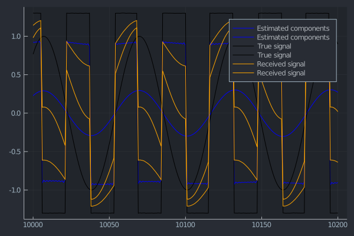
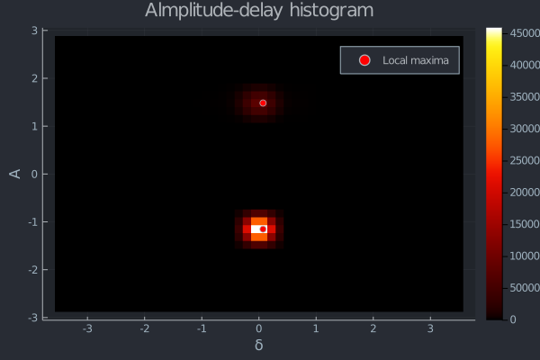

# IndependentComponentAnalysis

[](https://github.com/baggepinnen/IndependentComponentAnalysis.jl/actions)
[](https://codecov.io/gh/baggepinnen/IndependentComponentAnalysis.jl)


## ICA
This package modifies the implementation of the FastICA algorithm from [MultivariateStats.jl](https://github.com/JuliaStats/MultivariateStats.jl) to make it more than 5x faster. This comes at the expense of taking an additional dependency, on [LoopVectorization.jl](https://github.com/chriselrod/LoopVectorization.jl) and some additional compilation time.

This package also modifies the interface to the algorithm slightly, use it like this:

```julia
using IndependentComponentAnalysis
X = randn(4,100)
k = 2 # Number of components to extract
ica = fit(ICA, X, k; alg = FastICA(),
                fun       = Tanh(),
                do_whiten = true,
                maxiter   = 100,
                tol       = 1e-6,
                mean      = nothing,
                winit     = nothing
      )

Xt = transform(ica, X)
```

- The options for `fun` are `Tanh(a::Real)` and `Gaus()`
- MultivariateStats also exports `Tanh` and `Gaus`. When both packages are loaded, qualify these names as `IndependentComponentAnalysis.Tanh` and `IndependentComponentAnalysis.Gaus`.

### Diagnostics and whitening

```julia
using Random

model, info = fit(ICA, X, k;
    rng = MersenneTwister(42),
    return_info = true,
    on_nonconvergence = :throw,
)
info.converged
info.iterations
info.residual
info.numerical_rank
```

`return_info=true` returns the model and an `ICAInfo` record. The residual is the maximum absolute deviation of successive component inner-product magnitudes from unity. The default return value is an `ICA` model. Nonconvergence policies are `:log` (log an error and return the final iterate), `:throw` (throw `ConvergenceException`), and `:ignore` (return without logging). The low-level `ica!` function accepts the same diagnostics and nonconvergence options.

Random initialization uses the supplied `rng`; `winit` bypasses random initialization and must have full column rank. Repeated fits with equivalent RNG states and inputs use the same initialization. Component signs and ordering are not identifiable across different fits.

With whitening enabled, the numerical rank counts covariance eigenvalues greater than `max(rank_atol, rank_rtol * largest_eigenvalue)`. Defaults are `rank_atol=0` and `rank_rtol=sqrt(eps(eltype(X)))`. Requesting more components than this rank raises `ArgumentError`, including for constant data. The relative threshold excludes poorly conditioned covariance directions; decrease it explicitly if those directions are required. `info.numerical_rank` is `nothing` when whitening is disabled, in which case the input must already be whitened.

### Mixing matrices and reconstruction

```julia
sources = transform(model, X)
B = unmixingmatrix(model)
A = mixingmatrix(model)
X_reconstructed = reconstruct(model, sources)
X_selected = reconstruct(model, sources; components=[1, 2])
X_component = reconstruct(model, sources; components=1, add_mean=false)
```

`B` maps centered measurements to sources, and `A` is its Moore–Penrose pseudoinverse. Reconstruction accepts source vectors or matrices with one row per model component, including when selecting a subset. It adds the model mean once by default. Set `add_mean=false` when summing individual component contributions. An empty selection returns the mean, or zeros with `add_mean=false`.

For an invertible square unmixing matrix, reconstruction of all components recovers the measurements. With fewer components than measurement channels, it returns a minimum-norm reconstruction in the retained subspace. The mixing matrix follows the fitted source scaling and ordering; it does not determine physical source amplitudes or labels.

## DUET

[DUET](https://www.researchgate.net/publication/227143748_The_DUET_blind_source_separation_algorithm) (Degenerate Unmixing Estimation Technique) is an algorithm for blind source separation. It works on stereo mixtures and can separate any number of sources as long as they do not overlap in the time-frequency domain. The interface looks like this:


```julia
est, H = duet( x1, x2, n_sources, n = 1024;
                    p            = 1, # amplitude power used to weight histogram
                    q            = 0, # delay power used to weight histogram
                    amax         = 0.7,
                    dmax         = 3.6,
                    abins        = 35,
                    dbins        = 50,
                    kernel_size  = 1, # Controls the smoothing of the histogram.
                    bigdelay     = false,
                    kernel_sizeδ = 1,
                    window       = hanning,
                    kwargs..., # These are sent to the stft function
)
```

The returned values are `est::Matrix(time, n_sources)` and `H::DUET`.
`H` can be plotted `plot(H)`, which shows the delay/amplitude histogram and the identified peaks. Use this histogram to inspect peak locations and select histogram parameters.

- `bigdelay` indicates whether or not the two microphones are far apart. If `true`, the delay `δ` is estimated using the differential method (see the paper sec 8.4.1) and the delay map is smoothed using `kernel_sizeδ`.

### Energy thresholds, masks, and peak selection

```julia
est, H = duet(x1, x2, n_sources, 1024;
    min_bin_power = 1e-6,
    mask_type = :soft,
    mask_temperature = 0.1,
    min_peak_distance = 3,
    min_peak_ratio = 0.05,
)
```

`min_bin_power` is a relative power threshold applied separately to each microphone's largest non-DC time-frequency bin. Both microphone powers must exceed their respective thresholds. Rejected bins contribute neither to the histogram nor to the reconstructed sources. `H.reliable_bins` records retained bins without the DC row. The default threshold is zero, excluding zero-power bins.

The default `mask_type=:hard` assigns each retained bin to one source. `mask_type=:soft` distributes it across sources using normalized exponential weights of the attenuation-delay model errors, scaled by the combined microphone power. Smaller positive `mask_temperature` values produce more concentrated assignments. Soft masks sum to one across sources in each retained bin and to zero in rejected bins. They can reduce discontinuities in assignments, but do not guarantee improved separation quality.

`min_peak_distance` specifies minimum Euclidean peak spacing in histogram-bin coordinates. `min_peak_ratio` excludes peaks below that fraction of the histogram maximum. Both default to zero. If fewer distinct peaks are found than requested, DUET emits a warning and returns only the detected sources; inspect `length(H.av)` and the histogram. If no positive histogram energy remains, DUET raises `ArgumentError` with guidance on thresholds and bounds. These controls do not estimate the physical source count automatically.

#### Example:
```julia
t  = 0:0.1:2000
x1 = sin.(t)
x2 = @. 1.3 * sign(sin(2t + 0.2) ) + 0.001 * randn()
W  = [0.3 0.7; 0.6 0.4] # Mixing matrix
R  = W * [x1 x2]'
r1, r2 = R[1, :], R[2, :]

est, H = duet( r1, r2, 2, 1024,
    dmax        = 3.5,
    amax        = 2.8,
    kernel_size = 1,
)

plotinds = 10000:10200
plot(plotinds, est[plotinds,:], lab = "Estimated components", c = :blue)
plot!(plotinds, [x1 x2][plotinds,:], lab = "True signal", c = :black)
plot!(plotinds, [r1 r2][plotinds,:], lab = "Received signal", c = :orange) |> display

plot(H) |> display
```



### Creating mixture signals
```julia
mix   = mixture(signals, amps, [delays::Vector{Int}])
mixes = mixture(signals, amps::Vector{Vector}, [delays::Vector{Vector{Int}}])
```
Mixes together signals using amplitudes `amps` and `delays` (`delays` is specified in samples). If `amps` and the optional `delays` are vectors of vectors, then a vector of mixtures is returned. A vector of vectors is converted to a matrix using `M = reduce(hcat, mixes)`.
